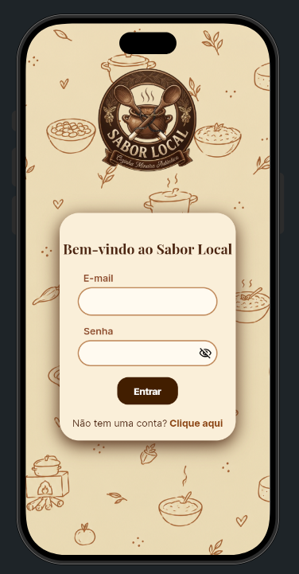
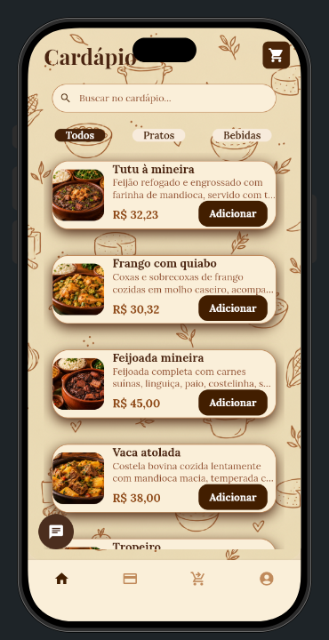
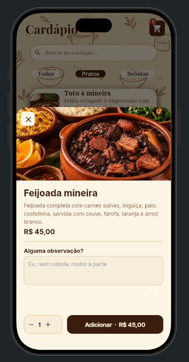
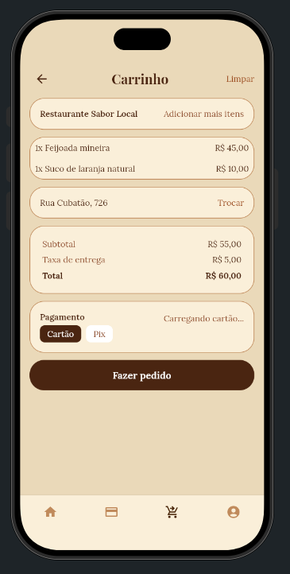

# 🍽️ Sabor Local – App de Delivery

App mobile do restaurante **Sabor Local**, de culinária mineira, desenvolvido
em grupo no curso de Análise e Desenvolvimento de Sistemas (Faculdade Impacta).

🔗 [Ver projeto no FlutterFlow](https://app.flutterflow.io/project/saborlocal-iqsi62)

## 📸 Telas
| Login | Cardápio | Detalhe do prato | Carrinho |
|:---:|:---:|:---:|:---:|
|  |  |  |  |

## ✨ Funcionalidades
- Cadastro de cliente com validação de e-mail, CPF, celular e senha
- Verificação de e-mail por código OTP (SendGrid)
- Login com token de autenticação
- Cadastro de endereço de entrega
- Cardápio com busca e filtro por categoria (pratos e bebidas)
- Detalhe do prato com observações e quantidade
- Carrinho com subtotal, taxa de entrega e escolha de pagamento (cartão ou Pix)
- Integração de clientes e pagamentos com Asaas (sandbox)
- Chatbot no Telegram (n8n + Gemini): dúvidas sobre o cardápio, FAQ do
  restaurante, recomendação de pratos e status do pedido

## 🛠️ Tecnologias
FlutterFlow · Xano (APIs REST e banco de dados) · n8n · Google Gemini ·
Telegram Bot API · Asaas · SendGrid
